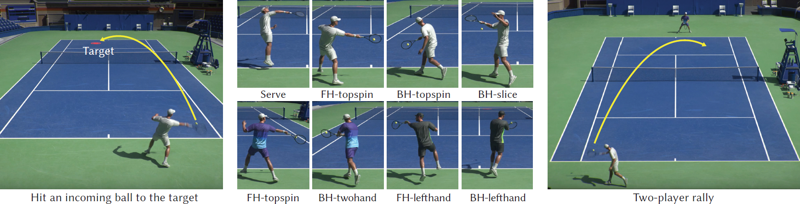

# Learning Physically Simulated Tennis Skills from Broadcast Videos

<strong>Haotian zhang</strong>, Ye Yuan, Viktor Makoviychuk, Yunrong Guo, Sanja Fidler, Xue Bin Peng, Kayvon Fatahalian

SIGGRAPH 2023 (best paper honorable mention) 

[Paper](https://research.nvidia.com/labs/toronto-ai/vid2player3d/data/tennis_skills_main.pdf) |
[Project](https://research.nvidia.com/labs/toronto-ai/vid2player3d/) |
[Video](https://youtu.be/ZZVKrNs7_mk) 



### Note: the current release provides the implementation of the hierarchical controller, including the low-level imitation policy, motion embedding and the high-level planning policy, as well as the environment setup in IsaacGym. Unfortunately, the demo can NOT run because the trained models are currently not available due to license issues. 

# News
[2023/11/28] Training code for the low-level policy is released.

[2023/11/01] Demo code for the hierarchical controller is released.

# Environment setup

### 1. Download IsaacGym and create python virtual env
You can download IsaacGym Preview Release 4 from the official [site](https://developer.nvidia.com/isaac-gym).
Then download Miniconda3 from [here](https://repo.anaconda.com/miniconda/Miniconda3-py37_23.1.0-1-Linux-x86_64.sh).
Create a conda virtual env named `rlgpu` by running `create_conda_env_rlgpu.sh` from IsaacGym, either python3.7 or python3.8 works.
Note you might need to run the following command or add it to your `.bashrc` if you encounter the error `ImportError: libpython3.7m.so.1.0: cannot open shared object file: No such file or directory` when running IsaacGym.
```
export LD_LIBRARY_PATH=<YOUR CONDA PATH>envs/rlgpu/lib/
``` 

### 2. Install dependencies 
Enter the created virtual env and run the install script.
```
conda activate rlgpu
bash install.sh
```
To install additional dependencies for the low-level policy, follow the instructions in [install_embodied_pose.sh](install_embodied_pose.sh). 

### 3. Install [smpl_visualizer](https://github.com/Haotianz94/smpl_visualizer) for visualizing results
Git clone and then run 
```
bash install.sh
```

### 4. Download data/checkpoints

Download [data](https://drive.google.com/drive/folders/1zuDOJWtjjGOL5ZWPlErv39ORfg0NEi_s?usp=sharing) into `vid2player3d/data`.

Download checkpoints of motion embedding and trained polices into `vid2player3d/results` (currently unavailable).

Download SMPL by first registering [here](https://smpl.is.tue.mpg.de/login.php) and then download the [models](https://download.is.tue.mpg.de/download.php?domain=smpl&sfile=SMPL_python_v.1.0.0.zip) (male and female models) into `smpl_visualizer/data/smpl` and rename the files as `SMPL_MALE.pkl` and `SMPL_FEMALE.pkl`.

For training the low-level policy, also copy the smpl model files into `vid2player3d/data/smpl`.

# Demo
These demos require trained models which are currently unavailable.
### Single player
In the single player setting, the player will react to consecutive incoming tennis balls from the other side.
The script below runs the simulation and renders the result online. The simulation will be reset after 300 frames. You can change the player by chaning`--cfg` to `djokovic` or `nadal`. 
```
python vid2player/run.py --cfg federer --rl_device cuda:0 --test --num_envs 1 --episode_length 300 --seed 0 --checkpoint latest --enable_shadow
```

The script below will run the simulations in batch and render the result videos offline and saved into `out/video`. You can also change `--record` to `--record_scenepic`, which will save the result into an interactive html file under `out/html`. Note that the saved html file is large and may take seconds to load.
```
python vid2player/run.py --cfg federer --rl_device cuda:0 --test --num_envs 8192 --episode_length 300 --seed 0 --checkpoint latest --select_best --enable_shadow --num_rec_frames 300 --num_eg 5 --record --headless
```

### Dual player
In the dual player setting, the two players will play tennis rally against each other.
The script below runs the simulation and renders the result online. The simulation will be reset if the ball is missed or out. You can change the players by changing `--cfg` to `nadal_djokovic`. More player settings will be added soon. 
```
python vid2player/run.py --cfg federer_djokovic --rl_device cuda:0 --test --num_envs 2 --episode_length 10000 --seed 0 --checkpoint latest --enable_shadow
```

The script below will run the simulations in batch and render the result videos offline and saved into `out/video`.
```
python vid2player/run.py --cfg federer_djokovic --rl_device cuda:0 --test --num_envs 8192 --episode_length 10000 --seed 0 --checkpoint latest --enable_shadow --headless --num_rec_frames 600 --num_eg 5 --record
```

# Training

Incoming ball pools and outgoing reward tables can be regenerated under a controller
YAML without overwriting existing data. See [ball preview regeneration](doc/ball_preview_regeneration.md)
for artifact selection, filtered incoming resampling, and `--test-only` MP4 mode.

### Low-level policy
We provide the code for training the low-level policy in [embodied_pose](embodied_pose). As described in the paper, the low-level policy is trained in two stages using AMASS motions and tennis motions. You can run the following script to execute the two-stage training (assuming the motion data are available).
```bash
python embodied_pose/run.py --cfg amass_im --rl_device cuda:0 --headless

python -u embodied_pose/run.py --cfg general_tennis_motion_filtered --rl_device cuda:0 --headless --results_dir ./output &> output_logs.txt

python -u embodied_pose/run.py --play --cfg general_tennis_motion_filtered --rl_device cuda:0 --headless --results_dir ./output/ --checkpoint latest --export_dataset &> export_dataset_logs.txt

python -u embodied_pose/run.py --cfg specific_on_general --play --checkpoint latest --record --num_rec_frames 300 --rec_fname saved_video.mp4 --results_dir ./output &> sim_logs.txt


python -u embodied_pose/run.py --cfg 0-Adrian_Mannarino_vs._Jiri_Lehecka_reencoded-scene000-000 --play --checkpoint latest --record --num_rec_frames 300 --rec_fname saved_video.mp4 --results_dir ./output &>> sim_logs.txt

# Try this when in waterloo
python -u embodied_pose/run.py --cfg specific_on_general --play --checkpoint latest --results_dir ./output
python -u embodied_pose/run.py --cfg specific_on_general --test --checkpoint epoch01000 --record --max_test_steps 20 --rec_fname video_saved.mp4 --results_dir  ./output &> output_log.txt

--test

```
[convert_amass_isaac.py](uhc/utils/convert_amass_isaac.py) shows how to convert the AMASS motion dataset into the format that can be used for our training code.

### Motion embedding
The [motion VAE](vid2player/motion_vae/README.md) learns a motion embedding from
low-level imitation exports. Its trained checkpoint supplies the motion model
used by the high-level policy. Export and convert the motion data, then start
training from `vid2player3d`:

```bash
python embodied_pose/run.py --play --cfg general_tennis_motion_filtered --rl_device cuda:0 --headless --results_dir ./output/ --checkpoint latest --export_dataset --num_envs 32  &> export_dataset_logs.txt

python vid2player/motion_vae/convert_export_dataset.py --input-yaml exports/motion_export_motion.yaml --out-dir tennis_dataset_physics

python vid2player/motion_vae/train.py --exp federer_physics &> mvae_logs.txt
```

For the US Open motion embedding, start training with:

```bash
PYTHONPATH=..:. python -u vid2player/motion_vae/train.py --exp usopen > logs/mvae_logs.txt 2>&1
```

See the [MVAE README](vid2player/motion_vae/README.md) for dataset format,
checkpoint resumption, reconstruction recordings, loss settings, validation,
and motion diagnostics.

### Motion exports
Motion exports are saved as `exports/<params.config.name>/<source_sequence_basename>.pk`.
The basename comes from the original sequence name stored in the motion library,
not the library shard filename. For `tennis_im_training_2`, the directory is
`exports/tennis_motion_2/`. Files retain the existing joblib payload format.

Each export run also writes `exports/<params.config.name>/metrics.csv`, with one
row per saved motion. It includes the exported filename, motion/environment IDs,
frame count and simulated duration, total/mean reward and reward components,
completion fraction, survival/completion flags, stop reason, tracking errors in
meters, and head-height diagnostics. `survived=1` means no early termination was
observed during the exported rollout; `completed_motion=1` additionally requires
reaching the reference motion's end. Episode/export step limits can leave a motion
incomplete even when it survived. Rows are flushed after each saved motion, and
the CSV is replaced on each export invocation (including single-motion exports).

Player logging defaults to `INFO`, showing progress and one result per motion.
Add `--log_level DEBUG` to include step-by-step diagnostics. `--verbose` retains
its separate meaning of recording a debug video when headless.


### High-level policy
We also provide code for training the high-level policy in [vid2player](vid2player). As described in the paper, we design a curriculum trained in three stages. You can run the following script to execute the curriculum training (assuming the checkpoints for the low-level policy and motion embedding are available).
```bash
python vid2player/run.py --cfg federer_train_stage_1 --rl_device cuda:0 --headless
python vid2player/run.py --cfg federer_train_stage_2 --rl_device cuda:0 --headless
python vid2player/run.py --cfg federer_train_stage_3 --rl_device cuda:0 --headless

#test:
PYTHONPATH=. python -u vid2player/run.py --cfg tennis_test --test --checkpoint latest --num_envs 1 --episode_length 300 --rl_device cuda:0
```


The phase-free US Open curriculum uses `--cfg usopen_train_stage_1`,
`usopen_train_stage_2`, then `usopen_train_stage_3`. See the
[US Open baseline notes](doc/usopen_high_level_baseline.md) for frozen checkpoint
compatibility, initialization, output protection, metrics and the ball-physics
audit. Run from `vid2player3d` with `PYTHONPATH=.`. These configurations select the
`usopen` MVAE option, which loads the `usopen_3` checkpoint directory.

# Citation

```
@article{
  zhang2023vid2player3d,
  author = {Zhang, Haotian and Yuan, Ye and Makoviychuk, Viktor and Guo, Yunrong and Fidler, Sanja and Peng, Xue Bin and Fatahalian, Kayvon},
  title = {Learning Physically Simulated Tennis Skills from Broadcast Videos},
  journal = {ACM Trans. Graph.},
  issue_date = {August 2023},
  numpages = {14},
  doi = {10.1145/3592408},
  publisher = {ACM},
  address = {New York, NY, USA},
  keywords = {physics-based character animation, imitation learning, reinforcement learning},
}
```

# References
This repository is built on top of the following repositories:
* Low-level imitation policy is adapted from [EmbodiedPose](https://github.com/ZhengyiLuo/EmbodiedPose)
* Motion embedding is adapted from [character-motion-vaes](https://github.com/electronicarts/character-motion-vaes)
* RL environment in IsaacGym is adapted from [ASE](https://github.com/nv-tlabs/ASE/)
  
Here are additional references for reproducing the video annotation pipeline:
* Player detection and tracking: [Yolo4](https://github.com/Tianxiaomo/pytorch-YOLOv4)
* 2D Pose keypoint detection: [ViTPose](https://github.com/ViTAE-Transformer/ViTPose)
* 3D Pose estimation and mesh recovery: [HybrIK](https://github.com/Jeff-sjtu/HybrIK)
* 2D foot contact [detection](https://github.com/yul85/movingcam)
* Global root trajectory optimization: [GLAMR](https://github.com/NVlabs/GLAMR)
* Tennis court line [detection](https://github.com/gchlebus/tennis-court-detection)


# Contact
For any question regarding this project, please contact Haotian Zhang via haotianz@nvidia.com.

### Headless imitation debug videos (SSH)

From `vid2player3d`, record a lightweight skeleton video without a display:

```bash
PYTHONPATH=.:.. python embodied_pose/run.py --cfg tennis_im_testing_2 \
  --rl_device cuda:0 --test --headless --verbose \
  --checkpoint results/amass_im/models/Humanoid_latest.pth \
  --rec_fname out/recording/amass_debug.mp4
```

`--headless --verbose` (or `--headless --record`) records environment 0 during
training, `--play`, or `--test`. The 512x256 MP4 shows a perspective 3D skeleton view with a floor grid:
blue is the simulated body and orange is its reference target. It uses Pillow
and imageio/FFmpeg on CPU, with no GUI or OpenGL renderer. The camera follows the
simulated pelvis horizontally and keeps the floor at world Z=0.

For testing/playback, the default video is stored with the evaluation report at
`<results_dir>/<cfg>/evaluations/<timestamp>/motion.mp4`. For training, it remains
`out/recording/debug_<timestamp>.mp4`. `--rec_fname` overrides either location;
relative paths are relative to the working directory. Parent directories are created.
`--num_rec_frames` defaults to 300; reaching the limit closes the video but lets
the run continue. Earlier completion or Ctrl-C finalizes the frames recorded so
far. `--rec_once` instead uses the longest loaded motion's duration as the limit.
The default playback FPS matches the control timestep (30 FPS with these configs);
`--rec_fps` overrides playback speed without changing simulation or sampling.

Playback checkpoints accept a direct `.pth` path, a suffix such as `latest`, or
`base` to use the configuration's `pretrained_model_cp`. Before tennis training,
use the AMASS path above; `tennis_im_testing_2`'s `base` points to the tennis
training output, which may not exist yet.

### Imitation evaluation reports

Every ordinary `--test` or `--play` run writes a new folder under
`<results_dir>/<cfg>/evaluations/<timestamp>/`, whether or not video is enabled:

- `history.csv`: per-step rewards, reward components, body-position error, pelvis
  position error, root-aligned body-position error, reference time and done flags.
- `summary.json`: per-episode reward totals, mean/max errors and stopping reason.
- `metrics.png`: reward, tracking-error and reward-component curves.
- `console.log`: Python console output during runner execution.
- `config.json`: arguments and configuration used for the run.
- `motion.mp4`: when headless recording is enabled and no custom filename is set.

Errors are measured in meters against the reference body origins, averaged over
bodies without reward weights. Root-aligned error removes pelvis translation,
not heading differences. These are tracking errors, not a count of discrete
mistakes. Metrics cover the actual rollout, even after the video frame limit.
The summary distinguishes height-based early termination, motion completion and
episode limits; interrupted runs preserve collected history and partial reports.
Dataset export has its own output workflow and does not create tracking reports.

300 recording frames is a maximum (10 seconds at 30 FPS), not a minimum episode
length. A 14-second source motion can produce a short video if the simulated body
hits its termination height threshold. `--num_rec_frames 450` raises the recording
cap, but does not bypass termination. For deliberate debugging beyond a fall,
set `env.enableEarlyTermination: False` in a separate debug configuration; motion
completion and episode limits still apply, and this changes the evaluation.

Imitation training writes epoch-aggregated TensorBoard metrics under
`<results_dir>/<cfg>/train/<experiment>/summaries`; for example, launch
`tensorboard --logdir output/tennis_im_training_2/train` to inspect training history.

Evaluation history also includes `head_height_m`, `reference_head_height_m`,
`head_termination_height_m` (the effective threshold), and `head_below_threshold`.
The height plot compares simulated and reference head body-origin world Z with
the threshold; this is not the top or bottom of the head mesh. Being below the
threshold only causes termination when early termination is enabled, after the
initial two steps, and when the head is not an excluded contact body.

Training additionally writes `metrics.jsonl` (one JSON object per epoch) next to
its `summaries/` directory. It includes actor/critic and bounds losses, entropy,
KL, clipping fraction, learning rate, rewards/components, alive ratio, episode
lengths when available, and timings/FPS. Losses are averages of optimizer
minibatches collected during that training epoch, not individual batch records.
TensorBoard uses training epoch as the horizontal step; the `frame` metric
retains the rollout-frame counter. Files are flushed each epoch. This persistence
was added to the custom imitation loop; older runs may have empty event files.
